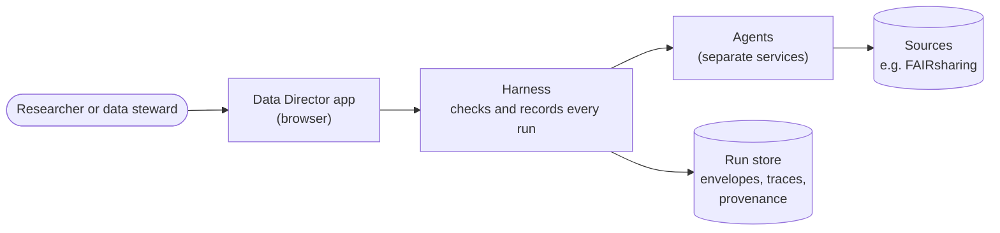
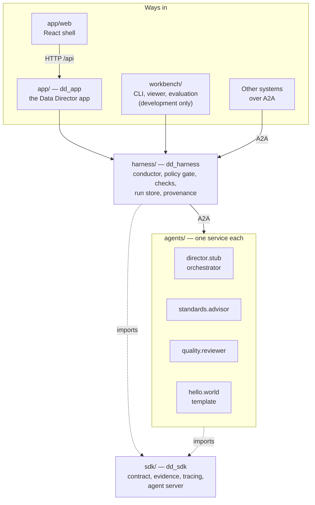
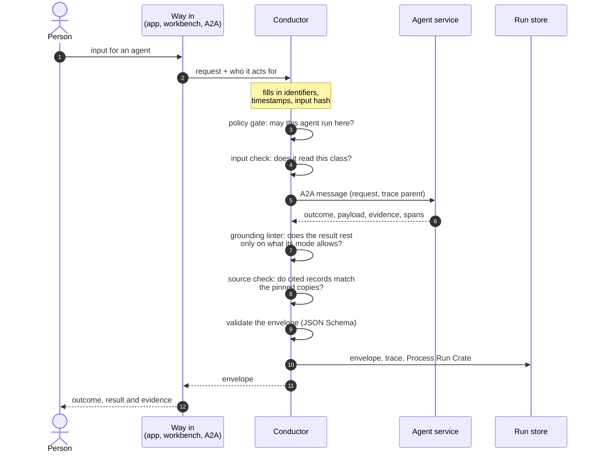
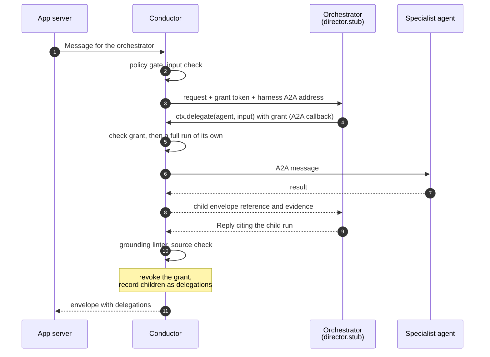
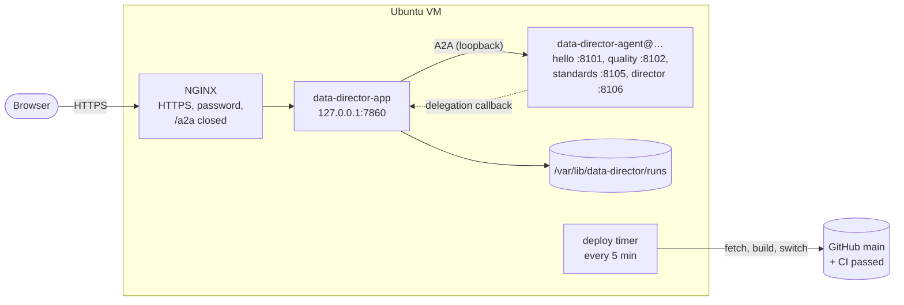

# Architecture

This page explains how the Data Director is put together. It starts with the whole system in one
picture and adds detail one level at a time, so a reader can stop at the level they need:

1. [The idea in one picture](#1-the-idea-in-one-picture): what the system is for.
2. [The parts](#2-the-parts): the packages in this repository and how they depend on each other.
3. [One run, step by step](#3-one-run-step-by-step): what the harness does every time an agent
   runs.
4. [Conversations and delegation](#4-conversations-and-delegation): how the orchestrator uses
   other agents.
5. [Configuration and deployment](#5-configuration-and-deployment): where it runs and who
   decides what it may do.

The reasons behind each choice are in the [decision records](adr/). Terms are defined in the
[glossary](glossary.md). For one run followed with real output, see the workbench's
[walkthrough](../workbench/docs/walkthrough.md).

## 1. The idea in one picture

The [Blueprint](https://doi.org/10.15497/RDA00157) describes a Data Director as one assistant a
researcher talks to, backed by specialist sub-agents: one recommends metadata standards, another
reviews a metadata record, and so on. In this implementation every agent runs under a
**harness** that checks what the agent did and records it.

Three ideas carry through the rest of this page.

- **Nothing reaches an agent except through the harness.** The app, the developer workbench and
  other systems all hand requests to the same function, the conductor. An agent is held to the
  same rules whichever way it is called.
- **An agent is a separate service with a declared contract.** Each agent says what input it
  reads, what result it returns and what that result may rest on (its *grounding mode*). The
  harness checks the agent against that declaration; it needs no code specific to any agent.
- **Every run ends in one record, the envelope.** It says what happened (`succeeded`,
  `abstained`, `referred`, `failed` or `suspended`), carries the result and the evidence it rests
  on, and names the person the run acted for. A refusal is an envelope too, not an exception.

## 2. The parts

The repository is a [uv](https://docs.astral.sh/uv/) workspace of separate Python packages, plus
the app's browser shell in TypeScript.

Solid arrows are calls at run time; dotted arrows are imports.

| Part | What it is | Read more |
|---|---|---|
| `sdk/` | What agents and the harness share: the contract (in LinkML, with generated JSON Schema), evidence hashing, tracing helpers, and the server that puts an agent behind A2A. | [`sdk/README.md`](../sdk/README.md), [contract](contract.md) |
| `harness/` | The governance every run goes through. Its centre is the conductor. It also serves its own A2A endpoint (`dd-harness serve`). | [`harness/README.md`](../harness/README.md), [conductor](../harness/docs/conductor.md) |
| `agents/` | One package and one A2A service per agent. `hello/` is the template for a new one. | [`agents/README.md`](../agents/README.md) |
| `app/` | The Data Director that people use (alpha). A Starlette server (`dd_app`) over the conductor, and a React shell (`app/web`) drawn from each agent's manifest. | [`app/README.md`](../app/README.md), [ADR-0024](adr/0024-app-shell.md) |
| `workbench/` | The test bed for people who write agents: a CLI, the Inspect and Chat pages, and evaluation. Not part of a deployment. | [`workbench/README.md`](../workbench/README.md) |

### The dependency rules

The boundaries between packages are deliberate, and tests enforce the most important one.

- `sdk` depends on nothing in the repository.
- `harness` depends only on `sdk`. It never imports the app, the workbench or an agent
  (`harness/tests/test_harness_boundary.py`).
- An agent depends only on `sdk`. The harness reaches it over A2A, not by import
  ([ADR-0011](adr/0011-remote-agents.md)).
- `app` and `workbench` each depend on `harness`, and never on each other. Neither imports an
  agent; each reaches every agent over A2A ([ADR-0027](adr/0027-no-agent-in-the-apps-process.md)).

This is why adding an agent needs no change to the harness, the app or the workbench: each of
them learns about the agent from its *agent card*, the document every A2A service publishes,
which carries the agent's `AgentSpec` ([registry](../harness/docs/registry.md)).

### The shared formats

Some things are fixed so that everything else can change. The contract's request and envelope,
the `dd.*` trace attributes, the evidence canonicalisations, the identifiers and the outcome
vocabulary are settled formats; changing any of them needs an ADR. The components that produce
and read them (agents, retrieval back ends, model explainers, front ends) sit behind interfaces
and can be replaced.

Each agent owns its own input and payload classes, declared in a LinkML file that imports the
shared core ([ADR-0019](adr/0019-core-contract-and-agent-owned-classes.md)). Its card carries
each class's JSON Schema, pinned by a digest, so the harness can check inputs and results
without a copy of the agent's code.

## 3. One run, step by step

A *run* is one agent invoked on one input. Every run, from any way in, goes through
`Conductor.invoke` in `harness/src/dd_harness/conductor.py`.

What each step is for:

- **Who the run acts for** comes from the way in, never from the request. Until there is sign-in,
  it is the one person the operator configured ([ADR-0018](adr/0018-acting-for.md)).
- **Policy gate.** The deployment's institutional profile says which agents are enabled, which
  action class each is assigned and which classes need a person's approval. A request cannot
  choose the profile ([ADR-0003](adr/0003-policy-profiles.md),
  [ADR-0017](adr/0017-policy-is-the-deployments.md)).
- **The agent** runs in its own process. It returns only an outcome, an optional payload and the
  evidence it used. The conductor, not the agent, sets identifiers, timestamps, telemetry and the
  grounding mode on the envelope.
- **Grounding linter.** Compares what the result cites with what the agent's trace shows it did,
  under the rules for its grounding mode: `retrieval`, `input_only`, `none` or `delegation`
  ([grounding](../harness/docs/grounding.md), [ADR-0008](adr/0008-grounding-modes.md)). It is a
  consistency check, not proof.
- **Source check.** Re-hashes each cited record against a pinned copy of its source, which does
  verify the citation ([ADR-0016](adr/0016-source-check.md)).
- **Run store.** Appends the envelope to `invocations.jsonl` and writes a folder per run with the
  request, envelope, trace, both checks' verdicts and a
  [Process Run Crate](adr/0021-ro-crate-is-a-record-not-a-message.md).

If a step refuses, the agent's result is withheld but the run is still recorded, and the person
gets an envelope that says why. Only a caller's own mistake (a malformed request, a reused
identifier, an unknown agent) raises an error instead. The step-by-step table, with each problem
type, is in [`conductor.md`](../harness/docs/conductor.md#the-steps).

## 4. Conversations and delegation

The app opens on a conversation with an orchestrator: the agent whose grounding mode is
`delegation`. Today that is `director.stub`, a rule-based stand-in that routes each message by the
patterns in its `routing.yaml`. A first message that matches no pattern is asked which of the
Blueprint's three entry points applies (before data collection, data being prepared for sharing,
ready to deposit), and the reply lists the steps from there, each with the agents that serve it or
"no agent yet" and its requirement ([ADR-0028](adr/0028-entry-points-and-serves.md)). An orchestrator answers by asking other agents, but it never calls them directly. It
asks the harness, so that every child run passes through every step above.

- The **grant** is a random token, valid only while the orchestrator's run is in progress. The
  callback arrives on the harness's own A2A endpoint (`/a2a`), which in the app accepts nothing
  else.
- Each child run is stored as a run of its own, in a trace linked to its parent, acting for the
  same person and gated by the same profile.
- A child is never given a grant, so delegation is one level deep.
- The app builds each message's history from the stored turns; a caller cannot supply one
  ([ADR-0024](adr/0024-app-shell.md) §17). Conversations are read back from the run store.

The rules are in [ADR-0012](adr/0012-conversation-and-orchestration.md) and
[`conductor.md`](../harness/docs/conductor.md#delegation).

## 5. Configuration and deployment

### The deployment decides

The harness ships no profile, agent list or source list. Each comes from the deployment, through
`DD_*` environment variables or defaults the way in passes to `Settings.from_env`:

| Setting | What it names |
|---|---|
| `DD_PROFILE` | The institutional profile: which agents may run, and with what approval. |
| `DD_AGENTS_CONFIG` | The list of agent URLs to read cards from. |
| `DD_SOURCES_CONFIG` | The pinned source copies the source check uses. |
| `DD_RUNS_DIR` | Where runs are written. |
| `DD_PRINCIPAL_ID`, `DD_PRINCIPAL_NAME` | Whom every run acts for, until there is authentication. |

The app's reference set is in `app/config/`; the workbench's development set is in `workbench/`.
Listing an agent makes it known; only the profile makes it permitted.

### Running it

On a developer's machine, `scripts/run-agents.sh` starts each agent on its own port and
`uv run data-director` starts the app (see the [README](../README.md#quick-start)). The shared
deployment is one Ubuntu VM that pulls `main` and serves it once CI has passed
([`deploy/README.md`](../deploy/README.md)):

The app and agents listen on loopback only, and NGINX asks for a password, because callers are
not yet authenticated: every run acts for the operator configured on the VM (#17). Do not expose
the app or the agents beyond a trusted network until that is done.

## Where to go next

| To understand | Read |
|---|---|
| What a request and an envelope contain | [`contract.md`](contract.md) |
| Each conductor step and its problem types | [`harness/docs/conductor.md`](../harness/docs/conductor.md) |
| Grounding modes and the linter's rules | [`harness/docs/grounding.md`](../harness/docs/grounding.md) |
| How agents are found and described | [`harness/docs/registry.md`](../harness/docs/registry.md) |
| How to write an agent | [`agents/README.md`](../agents/README.md) |
| The workbench's components, module by module | [`workbench/docs/architecture.md`](../workbench/docs/architecture.md) |
| How requirements are tested and reviewed | [`conformance.md`](conformance.md) |
| Why each decision was made | [`adr/`](adr/) |
