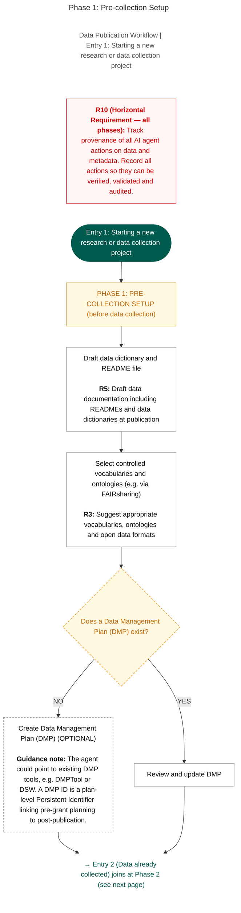

```mermaid
---
title: "Phase 2: Governance and Constraints of Research Data"
---
flowchart TD
    sub["Data Publication Workflow | Entry 2: Data already collected joins here"]:::subtitle
    r10["<b>R10 (Horizontal Requirement — all phases):</b> Track provenance of all AI agent actions on data and metadata. Record all actions so they can be verified, validated and audited."]:::horizontal
    sub ~~~ r10 ~~~ entry2

    entry2(["Entry 2: Data already collected — joins here"]):::entry
    phase2["PHASE 2: GOVERNANCE AND CONSTRAINTS OF RESEARCH DATA"]:::phase
    governs["Governs: funder policies, ethics, legal obligations, data sensitivity and embargo requirements"]:::caption
    policies["Check funder, journal and institutional data sharing policies<br><br><b>Guidance note:</b> Informs all subsequent decisions on sensitive data handling, ethical constraints and embargo period. The agent could connect to FAIRsharing policy records to surface relevant requirements. requirements."]:::step
    sensitive{"Is sensitive data present?"}:::decision
    anonymise["Anonymise or remove sensitive data<br><br><b>Guidance note:</b> The agent could warn, question or flag if sensitive data is detected. Data must be anonymised before the agent accesses it in cloud deployment. Air-gapped deployment allows more flexibility within a trusted boundary."]:::step
    nosensitive["No sensitive data — continue"]:::step
    constraints["Check ethical, legal and institutional constraints"]:::step
    embargo{"Is an embargo required?"}:::decision
    noembargo["No embargo required — continue"]:::step
    define["Define embargo period<br><br><b>Guidance note:</b> The agent could suggest a duration based on funder, journal and institutional requirements already identified above."]:::step
    verify["Verify data sharing at publication against Data Management Plan (DMP) commitments<br><br><b>R8:</b> Verify data sharing at publication against Data Management Plan (DMP) commitments"]:::step
    next["→ Entry 3 (Ready to deposit data) joins at Phase 3 (see next page)"]:::link

    entry2 --> phase2
    phase2 ~~~ governs
    governs --> policies --> sensitive
    sensitive -- YES --> anonymise
    sensitive -- NO --> nosensitive
    anonymise --> constraints
    nosensitive --> constraints
    constraints --> embargo
    embargo -- NO --> noembargo
    embargo -- YES --> define
    noembargo --> verify
    define --> verify
    verify --> next

    classDef subtitle fill:none,stroke:none,color:#555
    classDef caption fill:none,stroke:none,color:#555
    classDef horizontal fill:#fff5f5,stroke:#c00,color:#c00
    classDef entry fill:#005a4e,stroke:#005a4e,color:#fff
    classDef phase fill:#fff8e1,stroke:#c9a54a,color:#c66a00
    classDef step fill:#fff,stroke:#999,color:#111
    classDef optional fill:#fff,stroke:#999,color:#111,stroke-dasharray:4 3
    classDef decision fill:#fff8e1,stroke:#e08a00,color:#c66a00,stroke-dasharray:5 3
    classDef link fill:none,stroke:none,color:#005a4e
```

```mermaid
---
title: "Phase 3: Repository Selection"
---
flowchart TD
    sub["Data Publication Workflow | Entry 3: Ready to deposit data joins here"]:::subtitle
    r10["<b>R10 (Horizontal Requirement — all phases):</b> Track provenance of all AI agent actions on data and metadata. Record all actions so they can be verified, validated and audited."]:::horizontal
    sub ~~~ r10 ~~~ entry3

    entry3(["Entry 3: Ready to deposit data — joins here"]):::entry
    phase3["PHASE 3: REPOSITORY SELECTION"]:::phase
    assumes["Assumes governance and constraints checks are met"]:::caption
    mandated{"Is a repository mandated by funder, journal or institution?"}:::decision
    usemandated["Use mandated repository"]:::step
    find["Find a suitable repository (domain-specific or generalist)<br><br><b>Guidance note:</b> The agent could suggest options — the researcher selects. The agent distinguishes commercial from open repositories, surfaces deposit fees, and connects to FAIRsharing MCP server and re3data API.<br><br><b>R1:</b> Recommend and select repositories meeting funder, journal, institutional and community requirements"]:::step
    pids{"Does the repository assign Persistent Identifiers (PIDs) automatically?"}:::decision
    auto["PID auto-assigned (skip PID step at deposit)"]:::step
    arrange["Arrange PID assignment (e.g. via DataCite)<br><br><b>Guidance note:</b> The agent could support PID arrangement. PID assignment is the responsibility of the repository, not the researcher. PIDs include Handles and other GUPRIs (Globally Unique, Persistent and Resolvable Identifiers) — not DOIs only.<br><br><b>R7:</b> Support assignment of persistent identifiers (PIDs) at point of publication"]:::step
    access["Check access options and deposit costs<br><br><b>Guidance note:</b> The agent could surface information on access options, deposit fees and costs for the selected repository."]:::step
    cert["Check repository certification e.g. CoreTrustSeal (OPTIONAL)<br><br><b>Guidance note:</b> Free evaluation options are available via FAIRsharing and EDEN/FIDELIS for assessing repository quality. The agent should not weight paid certification more highly than free options."]:::optional
    next["→ Continues to Phase 4: Data Preparation and Metadata Creation (see next page)"]:::link

    entry3 --> phase3
    phase3 ~~~ assumes
    assumes --> mandated
    mandated -- YES --> usemandated
    mandated -- NO --> find
    usemandated --> pids
    find --> pids
    pids -- YES --> auto
    pids -- NO --> arrange
    auto --> access
    arrange --> access
    access ~~~ cert
    cert --> next

    classDef subtitle fill:none,stroke:none,color:#555
    classDef caption fill:none,stroke:none,color:#555
    classDef horizontal fill:#fff5f5,stroke:#c00,color:#c00
    classDef entry fill:#005a4e,stroke:#005a4e,color:#fff
    classDef phase fill:#fff8e1,stroke:#c9a54a,color:#c66a00
    classDef step fill:#fff,stroke:#999,color:#111
    classDef optional fill:#fff,stroke:#999,color:#111,stroke-dasharray:4 3
    classDef decision fill:#fff8e1,stroke:#e08a00,color:#c66a00,stroke-dasharray:5 3
    classDef link fill:none,stroke:none,color:#005a4e
```

```mermaid
---
title: "Phase 4: Data Preparation and Metadata Creation"
---
flowchart TD
    sub["Data Publication Workflow | Data preparation and metadata creation can run in parallel with each other"]:::subtitle
    r10["<b>R10 (Horizontal Requirement — all phases):</b> Track provenance of all AI agent actions on data and metadata. Record all actions so they can be verified, validated and audited."]:::horizontal
    sub ~~~ r10 ~~~ phase4

    phase4["PHASE 4: DATA PREPARATION AND METADATA CREATION"]:::phase
    clean["Clean, organise and version files"]:::step
    convert["Convert to open or non-proprietary formats (OPTIONAL)<br><br><b>Guidance note:</b> The agent could recommend formats and tools but does not perform conversion for large collections or complex pipelines. The researcher carries out conversion outside the agent where needed.<br><br><b>R3:</b> Suggest appropriate vocabularies, ontologies and open data formats"]:::step
    dict{"Was a data dictionary and README file created pre-collection?"}:::decision
    update["Review and update data dictionary and README file for data publication"]:::step
    create["Create data dictionary and README file<br><br><b>R5:</b> Draft data documentation including READMEs and data dictionaries at publication"]:::step
    standard["Identify metadata standard (usually dictated by repository) e.g. Dublin Core, DataCite"]:::step
    vocab["Finalise controlled vocabularies and ontologies"]:::step
    complete["Complete metadata fields in repository deposit form<br><br><b>R6:</b> Enable interoperable metadata across institutions and Data Director instances<br><br><b>R2:</b> Generate FAIR-aligned and discipline-appropriate metadata using controlled vocabularies, ontologies and community standards including CARE principles"]:::step
    next["→ Continues to Phase 5: Deposit and Submit (see next page)"]:::link

    phase4 --> clean --> convert --> dict
    dict -- YES --> update
    dict -- NO --> create
    update --> standard
    create --> standard
    standard --> vocab --> complete --> next

    classDef subtitle fill:none,stroke:none,color:#555
    classDef horizontal fill:#fff5f5,stroke:#c00,color:#c00
    classDef entry fill:#005a4e,stroke:#005a4e,color:#fff
    classDef phase fill:#fff8e1,stroke:#c9a54a,color:#c66a00
    classDef step fill:#fff,stroke:#999,color:#111
    classDef optional fill:#fff,stroke:#999,color:#111,stroke-dasharray:4 3
    classDef decision fill:#fff8e1,stroke:#e08a00,color:#c66a00,stroke-dasharray:5 3
    classDef link fill:none,stroke:none,color:#005a4e
```

```mermaid
---
title: "Phase 5: Deposit and Submit"
---
flowchart TD
    sub["Data Publication Workflow"]:::subtitle
    r10["<b>R10 (Horizontal Requirement — all phases):</b> Track provenance of all AI agent actions on data and metadata. Record all actions so they can be verified, validated and audited."]:::horizontal
    sub ~~~ r10 ~~~ phase5

    phase5["PHASE 5: DEPOSIT AND SUBMIT"]:::phase
    validate["Validate metadata quality and produce standardised assessments, recommendations and standards<br><br><b>Guidance note:</b> Metadata quality should be validated before the researcher submits the data, not after it has been deposited.<br><br><b>R4:</b> Validate metadata quality and produce standardised records assessed against community best practices, recommendations and standards"]:::step
    licence["Assign a licence for data reuse (CC BY/CC0) (often mandated by funder or journal)"]:::step
    link["Link to related outputs (publication DOI, ORCID, ROR, Grant ID)<br><br><b>Guidance note:</b> The agent could support linking to source code repositories (e.g. GitHub), institutional PIDs, Handles and FAIR Digital Objects (FDOs) — not only journal article publication DOIs.<br><br><b>R7:</b> Support assignment of persistent identifiers (PIDs) at point of publication"]:::step
    access["Set access restrictions (open / restricted / embargoed)"]:::step
    review["Generate private review link for manuscript peer reviewers (OPTIONAL)"]:::step
    upload["Upload files to repository"]:::step
    finalise["Review and finalise submission<br><br><b>Guidance note:</b> The researcher is responsible for the final data submission. The agent could suggest finalisation steps and point to repository-specific submission instructions."]:::step
    next["→ Continues to Phase 6: Post-Publication (see next page)"]:::link

    phase5 --> validate --> licence --> link --> access --> review --> upload --> finalise --> next

    classDef subtitle fill:none,stroke:none,color:#555
    classDef horizontal fill:#fff5f5,stroke:#c00,color:#c00
    classDef entry fill:#005a4e,stroke:#005a4e,color:#fff
    classDef phase fill:#fff8e1,stroke:#c9a54a,color:#c66a00
    classDef step fill:#fff,stroke:#999,color:#111
    classDef optional fill:#fff,stroke:#999,color:#111,stroke-dasharray:4 3
    classDef decision fill:#fff8e1,stroke:#e08a00,color:#c66a00,stroke-dasharray:5 3
    classDef link fill:none,stroke:none,color:#005a4e
```

```mermaid
---
title: "Phase 6: Post-Publication"
---
flowchart TD
    sub["Data Publication Workflow | Closes the loop back to planning"]:::subtitle
    r10["<b>R10 (Horizontal Requirement — all phases):</b> Track provenance of all AI agent actions on data and metadata. Record all actions so they can be verified, validated and audited."]:::horizontal
    sub ~~~ r10 ~~~ phase6

    phase6["PHASE 6: POST-PUBLICATION (closes the loop back to planning)"]:::phase
    note["Note: 'publication' in this phase refers specifically to journal article publication unless otherwise stated."]:::note
    exists{"Does a related journal article publication exist?"}:::decision
    flag["Flag as forward action: include data citation in related journal article when it is submitted or published<br><br><b>Guidance note:</b> The agent could record this as a pending task and remind the researcher at article submission stage."]:::step
    proceed["A related journal article publication exists — continue below"]:::step
    updatable{"Can the related journal article publication be updated?"}:::decision
    include["Include data citation in related journal article publication"]:::step
    relation["Note relationship in dataset metadata (isReferencedBy / isSupplementTo)<br><br><b>Guidance note:</b> The agent could capture the link between the dataset and the journal article even where the article cannot be updated."]:::step
    dmp["Update Data Management Plan (DMP) to reflect data published (mandatory where funders require)"]:::step
    cris["Record deposit in institutional systems (CRIS) — OPTIONAL<br><br><b>Guidance note:</b> This only applies where a CRIS system exists and deposit is required. The agent could identify whether this applies and provide guidance to help the researcher."]:::step
    monitor["Monitor access requests, downloads and citations"]:::step
    embargo["Check embargo status: has the related journal article been published? If yes, release dataset to public access<br><br><b>Guidance note:</b> Embargoed datasets are often not released to public access after the related journal article is published. The agent could monitor and alert the researcher when the dataset should be released."]:::step
    discover["Discover related datasets relevant to a research project<br><br><b>R12:</b> Discover related datasets relevant to a research project"]:::step
    fair["Evaluate the FAIRness of published digital objects (e.g. FAIRassist.org)"]:::step
    retrofit["Retrofit FAIR-aligned metadata for already-published datasets and supplementary materials<br><br><b>R9:</b> Retrofit FAIR-aligned metadata for already-published datasets and supplementary materials"]:::step
    outputs["Link datasets to related research outputs including journal article publications, people, grants and software<br><br><b>R11:</b> Link datasets to related research outputs including journal article publications, people, grants and software"]:::step
    finish(["End"]):::terminal

    phase6 ~~~ note
    phase6 --> exists
    exists -- NO --> flag
    exists -- YES --> proceed
    flag --> updatable
    proceed --> updatable
    updatable -- YES --> include
    updatable -- NO --> relation
    include --> dmp
    relation --> dmp
    dmp --> cris --> monitor --> embargo --> discover --> fair --> retrofit --> outputs --> finish

    classDef subtitle fill:none,stroke:none,color:#555
    classDef horizontal fill:#fff5f5,stroke:#c00,color:#c00
    classDef entry fill:#005a4e,stroke:#005a4e,color:#fff
    classDef phase fill:#fff8e1,stroke:#c9a54a,color:#c66a00
    classDef step fill:#fff,stroke:#999,color:#111
    classDef optional fill:#fff,stroke:#999,color:#111,stroke-dasharray:4 3
    classDef decision fill:#fff8e1,stroke:#e08a00,color:#c66a00,stroke-dasharray:5 3
    classDef link fill:none,stroke:none,color:#005a4e
    classDef note fill:none,stroke:none,color:#555
    classDef terminal fill:#c0392b,stroke:#c0392b,color:#fff
```

<!-- Generated by scripts/blueprint/convert.py from the Blueprint's Word original and checked against the published PDF by scripts/blueprint/check_text.py. Do not edit by hand. -->

# 8. Process Flow

This section presents the Data Director workflow as a six-phase process flow. The process flow translates the functional requirements set out in [Section 7.1](07-functional-specification.md#71-functional-requirements) into a practical, sequential representation of how the Data Director supports researchers and data support professionals across the research data publication lifecycle. It is intended to help implementers understand how the tool's capabilities fit together as a coherent workflow, and to give researchers and data support professionals a clear picture of when and how the tool becomes relevant at each stage of their work.

The process flow was developed iteratively by Working Group members across two facilitated sessions using [Miro](https://miro.com/app/board/uXjVHXDM1Ig=/?share_link_id=139484060485),[^59] a collaborative online whiteboard, with participants contributing directly to the design in real time by adding steps, questioning sequencing, and refining individual process boxes. The guidance notes visible throughout the diagrams are drawn directly from Working Group contributions and record the reasoning behind specific design decisions. The workflow is therefore not a post-hoc illustration of the functional requirements but a community-designed artefact, developed in parallel with the specification and shaped by the practical knowledge of researchers, data support professionals and implementers across the Working Group.

The workflow is not prescriptive about technology or platform. It describes what happens, in what order, and where human decisions are required, without specifying how any individual implementation should deliver each step. Implementers should use it as a reference for designing workflows and configuring the tool within their own institutional context, guided by the implementation profiles in [Section 11](11-implementation-guidance.md).

## 8.1 How to read the process flow

The workflow is structured in six phases, presented across six figures. The phases follow the sequence in which research data publication work typically unfolds, setting up before data collection; confirming governance and legal constraints; selecting a repository; preparing data and creating metadata; depositing and publishing; and managing outputs after publication. Together, the six phases cover the full journey from project planning to post-publication data reuse.

Researchers do not always enter the process at the beginning. Three entry points are provided to reflect this. Entry 1, shown in [Figure 1](#figure-1), is for researchers starting a new project before data collection begins. Entry 2, shown in [Figure 2](#figure-2), is for researchers whose data has already been collected and who are beginning to prepare it for sharing. Entry 3, shown in [Figure 3](#figure-3), is for researchers who are ready to deposit data into a repository. All three paths converge and complete the same final phases.

Each figure uses a consistent set of visual conventions:

- Process steps are shown as plain rectangular boxes representing actions or tasks.

- Decision points are shown as diamond shapes with dashed orange borders, each presenting a yes/no question that branches the flow.

- Entry points are shown as rounded green ovals marking where a researcher joins the workflow.

- Phase headers are shown as orange-bordered bars that mark the transition between workflow phases.

- Functional requirement boxes, shown with an orange left border inside a process step, identify which requirement from [Section 7.1](07-functional-specification.md#71-functional-requirements) is being applied at that point.

- Guidance note boxes, shown with a blue left border, record session feedback and clarifying notes from the Working Group.

- Optional steps are shown with a dashed border.

- Arrows indicate the direction of flow throughout.

One requirement runs across all six phases without exception. R10, track provenance of AI agent actions on data and metadata, is shown as a red banner at the top of every figure. It applies to every action the Data Director takes throughout the entire workflow. This reflects the Blueprint's position that provenance recording is not a phase-specific capability but a foundational condition for trustworthy agentic AI operation. Every agent action must be recorded, and those records must be available for verification, validation and audit at any point.

## 8.2 Six-Phase Process Flow for Research Data Publication

The process flow described here represents an example pathway through the research data publication workflow as experienced by the researcher. It shows the stages a researcher moves through when preparing and depositing research data and identifies the points at which the Data Director can interact with and provide support to that process. The workflow belongs to the researcher; the Data Director's role is to assist, recommend, and flag, not to direct or control. In practice, the sequence and emphasis of phases may vary depending on researcher context, institutional requirements, data sensitivity, and whether the dataset is being prepared for first-time publication or retrospective improvement.

Several design decisions embedded in the process flow are worth drawing attention to explicitly.

Repository selection, shown in Phase 3 ([Figure 3](#figure-3)), should be initiated before metadata generation begins, not only before deposit. The selected repository determines the required metadata schema, controlled vocabularies and validation rules that will govern all subsequent metadata work. Implementers should ensure that the tool prompts users to confirm or select a repository before the metadata creation workflow in Phase 4 is triggered ([Figure 4](#figure-4)).

Governance and constraints checks, shown in Phase 2 ([Figure 2](#figure-2)), precede repository selection and should inform all subsequent decisions. Sensitive data handling, ethical and legal constraints, embargo periods and DMP verification are all addressed at this stage so that the decisions made here can constrain and guide the steps that follow. This ordering reflects the Blueprint's position in [Section 5.2](05-blueprint-considerations.md#52-legal-ethical-and-sovereignty-prerequisites) that legal and ethical permissibility must be confirmed before any sharing workflow is enabled.

Metadata quality validation, shown in Phase 5 as R4 ([Figure 5](#figure-5)), is placed before submission rather than after. This reflects Working Group feedback that quality issues should be identified and resolved while the researcher can still act on them, not discovered after data has been published.

The post-publication phase, shown in Phase 6 ([Figure 6](#figure-6)), is not the end of the process but a continuing loop. The Data Director may support embargo monitoring after deposit. It can also support retrospective metadata improvement for already-published datasets (R9) and the linking of datasets to related research outputs (R11). Implementers should design their deployments to remain active and useful to researchers beyond the point of deposit.

**Figure 1**. Phase 1: Pre-collection Setup. The workflow entry point for researchers starting a new project before data collection begins. Shows the initial drafting of data documentation (R5), selection of controlled vocabularies and ontologies (R3), and a decision step to create a new Data Management Plan or review an existing one.

**Figure 2.** Phase 2: Governance and Constraints of Research Data. Covers the governance checks that must be completed before repository selection or data deposit proceeds. Includes checking funder, journal and institutional data sharing policies; identifying and handling sensitive data; confirming whether an embargo is required; and verifying data sharing commitments against the Data Management Plan (R8).

**Figure 3.** Phase 3: Repository Selection. Covers the selection and confirmation of a suitable data repository. Includes checking whether the funder, journal or institution mandates a repository; recommending an appropriate repository where one is not mandated (R1); confirming whether persistent identifiers (PIDs) are assigned automatically by the repository or arranging assignment where needed (R7); checking access options and deposit costs; and optionally verifying repository certification.

**Figure 4.** Phase 4: Data Preparation and Metadata Creation. Covers the preparation of data files and the creation of metadata records. Includes file cleaning and versioning; open format recommendations (R3); creation or review of data documentation, including READMEs and data dictionaries (R5); identification of the appropriate metadata standard; and completion of metadata fields using FAIR-aligned, discipline-appropriate vocabularies and ontologies (R2, R6).

**Figure 5.** Phase 5: Deposit and Submit. Covers the final steps before a dataset is submitted to a repository. Includes metadata quality validation (R4); licence assignment; linking to related research outputs including publication DOIs, ORCID, ROR and Grant IDs (R7); setting access restrictions; generating a private peer review link (optional); uploading files; and researcher review and finalisation of the submission.

**Figure 6.** Phase 6: Post-Publication. Covers the actions that follow data deposit and closes the loop back to planning. Includes updating the Data Management Plan; recording deposit in institutional systems where required; monitoring access, downloads and citations; checking embargo release; evaluating the FAIRness of published digital objects and discovering related datasets (R12); retrofitting FAIR-aligned metadata for existing datasets (R9); and linking datasets to related research outputs (R11).

[^59]: <https://miro.com/app/board/uXjVHXDM1Ig=/?share_link_id=139484060485>
