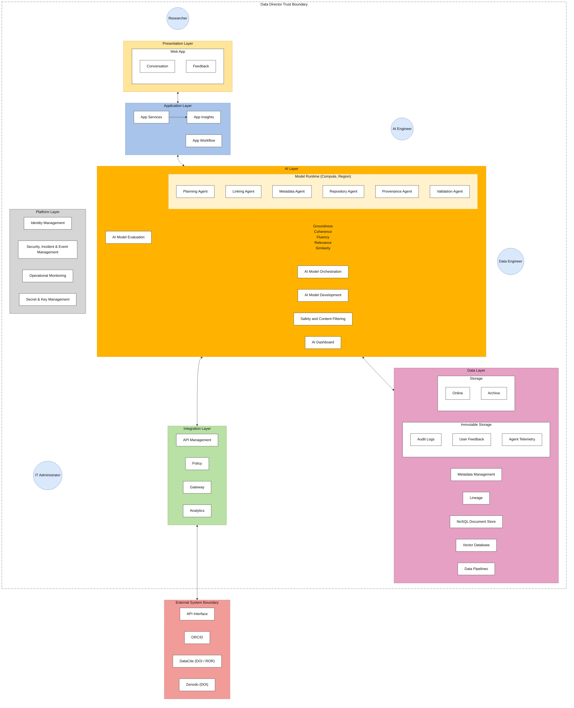

<!-- Generated by scripts/blueprint/convert.py from the Blueprint's Word original and checked against the published PDF by scripts/blueprint/check_text.py. Do not edit by hand. -->

# 9. Reference Architecture

The architecture Blueprint provides a vendor-agnostic, technology-neutral map of the Data Director system components and how they interact. The Blueprint is also agnostic of the implementation scenario, such as cloud or hybrid cloud.

## 9.1 Architecture Overview

The diagram depicted below ([Figure 7](#figure-7)) illustrates the core capabilities required to support the data director implementation based on the principles and requirements identified during the working group discovery sessions.

**Assumptions:**

- Language support will be dependent on the chosen cloud/technology provider and requirements during implementation.

- High availability and disaster recovery requirements are dependent on the scenario and service level agreement (SLA) requirements during implementation.

- The architecture Blueprint is based on a greenfield implementation (a new implementation built from scratch) and does not account for all possible existing capabilities. It is recognised, however, that research organisations may already have services in place, including identity management and operational monitoring.

**Figure 7.** The Data Director conceptual architecture is a multi-layered AI platform that enables researchers to interact with intelligent agents for metadata, provenance, and repository management, underpinned by secure data storage, API integration with external scholarly systems, and governed platform infrastructure.

## 9.2 Presentation Layer

The presentation layer covers the interfaces through which users interact with the Data Director ([Table 5](#table-5)). It must be accessible, responsive and clearly communicate AI-generated content separately from verified data.

**Table 5.** Presentation layer component, with its description and associated requirement, through which users interact with the Data Director

| **Component**                                                 | **Description/Requirement**                                                                                                                                                                                                                                             |
|---------------------------------------------------------------|-------------------------------------------------------------------------------------------------------------------------------------------------------------------------------------------------------------------------------------------------------------------------|
| **Web app providing a chat interface and feedback mechanism** | Supporting a chat-based interface which also allows the end-user to provide feedback on AI generated actions and output. Important note: the end user experience is subject to requirements specific to the research institution and implementation scenario and scope. |

## 9.3 Application Layer

The application layer contains the core business logic of the Data Director: orchestrating user requests, managing workflows and coordinating between the AI and data layers ([Table 6](#table-6)).

**Table 6.** Application layer components, with their descriptions and associated requirements, that orchestrate the Data Director's core business logic.

| **Component**    | **Description/Requirement**                                                                                                                                              |
|------------------|--------------------------------------------------------------------------------------------------------------------------------------------------------------------------|
| **App Services** | Application Services which provide the compute and elastic scale to serve the end-user experience and interaction with underlying AI services.                           |
| **App Insights** | Application observability services which capture telemetry (usage, adoption, success, failure, audit information) which is useful for insights and troubleshooting.      |
| **App Workflow** | Application-layer capability that orchestrates and manages end-to-end business processes across systems, users, and services in a reliable, stateful, and auditable way. |

## 9.4 AI Layer

The AI layer contains all artificial intelligence and machine learning components ([Table 7](#table-7)). This Blueprint does not prescribe specific models or vendors; it defines what the AI layer must do and how it must behave.

**Table 7.** AI layer components, with their descriptions and associated requirements, that provide the artificial intelligence and machine learning capabilities and agents underpinning the Data Director.

| **Component**                    | **Description/Requirement**                                                                                                                                                                                                                                     |
|----------------------------------|-----------------------------------------------------------------------------------------------------------------------------------------------------------------------------------------------------------------------------------------------------------------|
| **AI Model Orchestration**       | AI capability responsible for coordinating, managing, and optimising the use of the AI agents and services to deliver reliable, consistent, and context-aware outcomes                                                                                          |
| **AI Model Evaluation**          | AI capability responsible for systematically measuring, validating, and continuously assessing the performance, safety, and business effectiveness of AI models and agent behaviours                                                                            |
| **AI Model Development**         | AI capability which provides the end-to-end development and data science environment and processes for creating AI solutions, spanning data preparation, model selection, prompt and agent design, training or fine-tuning, and packaging models for deployment |
| **Safety and Content Filtering** | AI capability which enforces organisational, ethical, responsible and regulatory guardrails across all AI agent inputs and outputs to ensure that interactions remain safe, compliant, and appropriate for the intended use case                                |
| **AI Dashboard**                 | Provides monitoring, and operational insight into the performance, usage, cost, quality, and safety of AI models, agents, and workflows across an organisation                                                                                                  |
| **Model Runtime**                | Core application-layer capability responsible for executing AI models in production and managing the full lifecycle of inference requests in a reliable, scalable, and secure way                                                                               |
| **Planning Agent**               | Verifies DMP alignment, suggest open formats, draft readme and data dictionary                                                                                                                                                                                  |
| **Linking Agent**                | Links related outputs, connect datasets/publications, PID assignment                                                                                                                                                                                            |
| **Metadata Agent**               | Generates discipline aligned metadata, prepares metadata for deposit                                                                                                                                                                                            |
| **Repository Agent**             | Discovers related datasets, recommend repositories (repository selection)                                                                                                                                                                                       |
| **Provenance Agent**             | Records traceability, lineage                                                                                                                                                                                                                                   |
| **Validation Agent**             | Validates standards compliance, FAIR-alignment, governance constraints                                                                                                                                                                                          |

## 9.5 Data Layer

The data layer manages all persistent storage, including dataset submissions, metadata records, policy configurations, audit logs and the knowledge sources used by the AI components ([Table 8](#table-8)).

**Table 8.** Data layer components, with their descriptions and associated requirements, that manage persistent storage, metadata, lineage, and operational memory for the Data Director.

| **Component**            | **Description/Requirement**                                                                                                                                                                                                                                                                                                                                                           |
|--------------------------|---------------------------------------------------------------------------------------------------------------------------------------------------------------------------------------------------------------------------------------------------------------------------------------------------------------------------------------------------------------------------------------|
| **Metadata Management**  | Data service capability that stores, governs, and exposes structured information about AI systems, data assets, models, agents, prompts, tools, and workflows to enable discoverability, governance, reuse, and traceability across the AI lifecycle                                                                                                                                  |
| **Lineage**              | Data service capability which records the end-to-end history, dependencies, and flow of data, prompts, models, and outputs across an AI system to provide full traceability from source to outcome                                                                                                                                                                                    |
| **Storage**              | Foundational capability responsible for storing and retrieving all data, artefacts, and operational state required by AI models, agents, workflows, and supporting services                                                                                                                                                                                                           |
| **Immutable Storage**    | Storage capability designed to securely capture, preserve, and retain all critical AI system events, such as audit logs, user feedback, agent traces, and operational telemetry, in a tamper-evident, write-once, append-only format                                                                                                                                                  |
| **Vector Database**      | Data service capability that stores, indexes, and retrieves high-dimensional vector representations of data to enable semantic search and Retrieval-Augmented Generation (RAG) in AI systems. Enables intelligent search and context injection by storing and retrieving meaning-based representations of enterprise knowledge to ground AI outputs in accurate, relevant information |
| **Data Pipelines**       | Responsible for ingesting, conditioning, transforming, moving, and preparing data across systems while ensuring sensitive information can be securely masked, anonymised, or pseudonymised in accordance with governance, privacy, and compliance requirements.                                                                                                                       |
| **NoSQL Document Store** | NoSQL capability used as the operational memory layer for AI systems and agents. It stores semi-structured information such as conversation history (memory), user profiles, session state, workflow checkpoints, and derived “semantic memories” used for retrieval-augmented generation (RAG).                                                                                      |

## 9.6 Platform and Integration Layer

The platform layer provides the computation, networking, identity and messaging infrastructure on which the Data Director runs. The integration layer manages connectivity with external systems ([Table 9](#table-9)).

**Table 9.** Platform and integration components, with their descriptions and associated requirements, that manage computation, networking, identity and messaging infrastructure for the Data Director.

| **Component**                               | **Description/Requirement**                                                                                                                                                                                                                                                                                                                                                                                                                                                                                                                                                                                                        |
|---------------------------------------------|------------------------------------------------------------------------------------------------------------------------------------------------------------------------------------------------------------------------------------------------------------------------------------------------------------------------------------------------------------------------------------------------------------------------------------------------------------------------------------------------------------------------------------------------------------------------------------------------------------------------------------|
| **API Management**                          | Integration capability that provides a controlled, secure gateway for exposing, governing, and consuming APIs across internal and external services such as DataCite and Zenodo, etc.. It acts as the front door for all system-to-system communication, ensuring that APIs used by AI agents, workflows, applications, and external consumers are consistent, secure, and properly governed.                                                                                                                                                                                                                                      |
| **Identity Management**                     | Foundational capability which is responsible for establishing, verifying, and governing the identities of users, applications, services, and AI agents, and controlling what they are allowed to access across the system. It acts as the trust and authentication backbone for authentication (confirming that an entity is who it claims to be) and authorisation (determines what an authenticated identity is permitted to do).                                                                                                                                                                                                |
| **Security, Incident and Event Management** | Capability which provides security observability and threat detection layer of an AI-enabled enterprise, providing real-time visibility into suspicious activity, policy violations, and potential security incidents across all system components, including AI agents, model runtimes, APIs, and data services. The service also supports real-time alerting and incident detection, triggering notifications when predefined rules or machine learning models detect anomalies, policy violations, or known attack signatures. These alerts can be routed to security teams, automated response systems, or incident workflows. |
| **Operational Monitoring**                  | Provides continuous visibility into the health, performance, availability, and reliability of applications, AI systems, workflows, and underlying infrastructure in real time.                                                                                                                                                                                                                                                                                                                                                                                                                                                     |
| **Secret and Key Management**               | Responsible for securely storing, distributing, rotating, and controlling access to sensitive credentials such as API keys, encryption keys, certificates, passwords. It acts as the cryptographic trust and secret protection layer of an AI platform, ensuring that sensitive information is never exposed in code, configuration files, logs, or AI prompts, and is only accessed in a controlled and auditable way.                                                                                                                                                                                                            |
