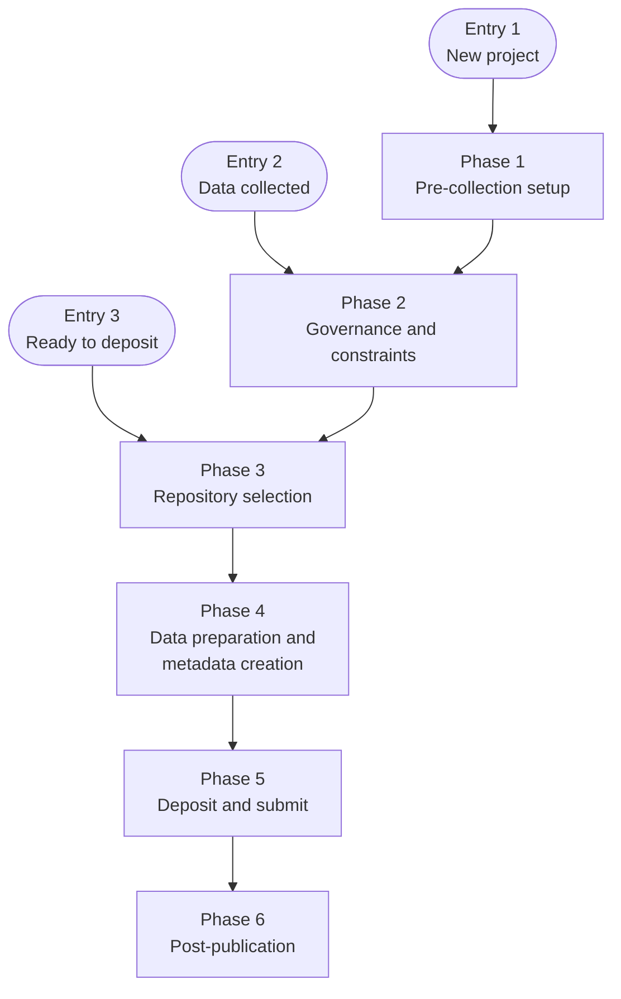

# The workflow: entry points and phases

Data Director follows the process flow in the Blueprint
([§8](../../blueprint/08-process-flow.md)): six phases, joined at one of three entry points. This
page is a map of that flow, so you can see where you are in your work and what the Data Director
can help with from there.

The workflow is yours. The Data Director assists, recommends and flags; it does not direct or
control your work, and you can skip, repeat or reorder steps to suit your project.

## Choose an entry point

Researchers do not always start at the beginning. Say which of the three describes you.

| Entry | Where you are | You join at |
|-------|---------------|-------------|
| **Entry 1** | Starting a new project, before data collection begins | Phase 1 |
| **Entry 2** | Data already collected, being prepared for sharing | Phase 2 |
| **Entry 3** | Ready to deposit data into a repository | Phase 3 |

All three continue through every later phase to the end.

When you create a project, the Data Director first asks a few setup questions that place it
in this flow. They take the message box's place: select **Reply in my own words instead** to type
a message, and **Answer the setup questions instead** under the box to go back to them, as you
left them. A message you send leaves the questions to answer later. **Attach a file** beside the
questions adds a document to the project straight away. Once you have answered them, it tells you
which phase you start at and suggests a first step. Select **Start with** that step to begin the
conversation there, or **Not now** to close the questions and type your own message.

On a first message that names no entry point, the Data Director asks which one you mean, with
the three entry points as choices beneath its reply. Choose one and select **Send answer**, or
type your answer instead: "Entry 2", or your situation in your own words ("I have collected my
data and want to share it"). It then lists the steps from that entry onwards and the agents that
can help with each.

The Data Director asks other questions with a few known answers the same way. You never have to
use the choices: whatever you type in the message box is sent as your reply.

## The map

## The phases and their steps

Each step names the Blueprint requirement it applies (R1 to R12, from
[§7.1](../../blueprint/07-functional-specification.md#71-functional-requirements)), where there is
one. Steps marked *optional* may be left out.

### Phase 1: Pre-collection setup

*Entry 1 starts here.* The app calls this phase "Plan your data management". It is about planning
how the data will be managed as a whole, not only how they will be described: how they will be
collected, documented, stored and protected, shared and preserved, and for how long; who is
responsible; and what it will cost. The Data Management Plan written here is a living document,
reviewed and updated as the research proceeds and again after publication (Phase 6).

- Draft the data documentation (R5)
- Select controlled vocabularies and ontologies (R3)
- Create a Data Management Plan where none exists (*optional*)
- Review and update the Data Management Plan

### Phase 2: Governance and constraints

*Entry 2 starts here.* These checks come before repository selection and constrain everything
after them.

- Check funder, journal and institutional data sharing policies
- Identify sensitive data
- Handle sensitive data
- Confirm whether an embargo is required
- Verify data sharing commitments against the Data Management Plan (R8)

### Phase 3: Repository selection

*Entry 3 starts here.* Choose the repository before you create metadata: it decides the metadata
schema, vocabularies and validation rules for Phase 4.

- Check whether the funder, journal or institution mandates a repository
- Recommend a repository where none is mandated (R1)
- Confirm or arrange persistent identifier (PID) assignment (R7)
- Check access options and deposit costs
- Verify repository certification (*optional*)

### Phase 4: Data preparation and metadata creation

- Clean and version the data files
- Recommend open formats (R3)
- Create or review data documentation: READMEs and data dictionaries (R5)
- Identify the appropriate metadata standard
- Complete metadata fields with FAIR-aligned, discipline-appropriate vocabularies and ontologies
  (R2, R6)

### Phase 5: Deposit and submit

Metadata is validated before submission, while you can still act on what is found. Data Director
builds the deposit package; you then deposit it in the repository yourself, as
[Depositing your data](depositing.md) explains.

- Validate metadata quality (R4)
- Assign a licence
- Link to related research outputs: publication DOIs, ORCID, ROR and grant IDs (R7)
- Check how FAIR the draft metadata record is before submitting (*optional*; not in the
  Blueprint's figure, added so that you can act on it before you deposit)
- Set access restrictions
- Generate a private peer review link (*optional*)
- Upload the files ([Depositing your data](depositing.md))
- Review and finalise the submission

### Phase 6: Post-publication

Publication is not the end. This phase is a continuing loop.

- Update the Data Management Plan to reflect the data published
- Record the deposit in institutional systems where required
- Monitor access, downloads and citations
- Check embargo release
- Evaluate the FAIRness of the published objects and discover related datasets (R12): this
  re-checks the record as published, after the check you can make before you submit
- Retrofit FAIR-aligned metadata for existing datasets (R9)
- Link datasets to related research outputs (R11)

In every phase, each action an agent takes on your data and metadata is recorded with its
evidence: see [What the Data Director records](records.md).

## How you interact with it

1. **Say where you are.** Start a conversation ([Using the conversation](conversation.md)) and name your entry point.
2. **Read the plan.** The Data Director lists the steps from your entry point. For each step it
   shows the requirement and the agents that serve it.
3. **Hand a step to an agent.** The Data Director delegates the step to an agent through the
   harness, or you open the agent directly and use its **Run** tab
   ([Running an agent](running-an-agent.md)). The harness checks the agent kept to the contract
   and records the run.
4. **Check the result.** Every result carries an [outcome](outcomes.md) and the evidence it rests
   on. You decide what to do with it.
5. **Move on.** Continue to the next step, or return to an earlier one.

### Steps with no agent

An agent joins a step by declaring the steps it serves. Where no registered agent serves a step,
the Data Director says that it cannot help with that step yet, gives some background on what the
step usually involves, and offers steps it can help with. It does not skip the step or do the work
itself. The set of steps with an agent depends on which
agents your deployment has registered, so the list differs between deployments. [The agents](agents.md)
lists them and the steps each serves.

The **Data management phases** strip above the conversation in the app shows the same phases in
order. Open it to see, for each step, the agents here that serve it. It does not yet show where your own project has reached in them
(TODO(#160)).

## What is not covered

- **Governance as an entry point.** Routing researchers down open, restricted or unshared paths is
  deferred by the Blueprint to v2.0.
- **The figures themselves.** The steps above are taken from the figure captions in
  [§8.2](../../blueprint/08-process-flow.md#82-six-phase-process-flow-for-research-data-publication).
  They may omit steps or decisions that the figures show (TODO(#245)).

## Where this is defined

The entry points and phases are data in the SDK (`dd_sdk.process_flow`), the same for every agent
and deployment. [Orchestration](../../specs/orchestration.md) records the decision; the
[Blueprint chapter](../../blueprint/08-process-flow.md) is the source.
