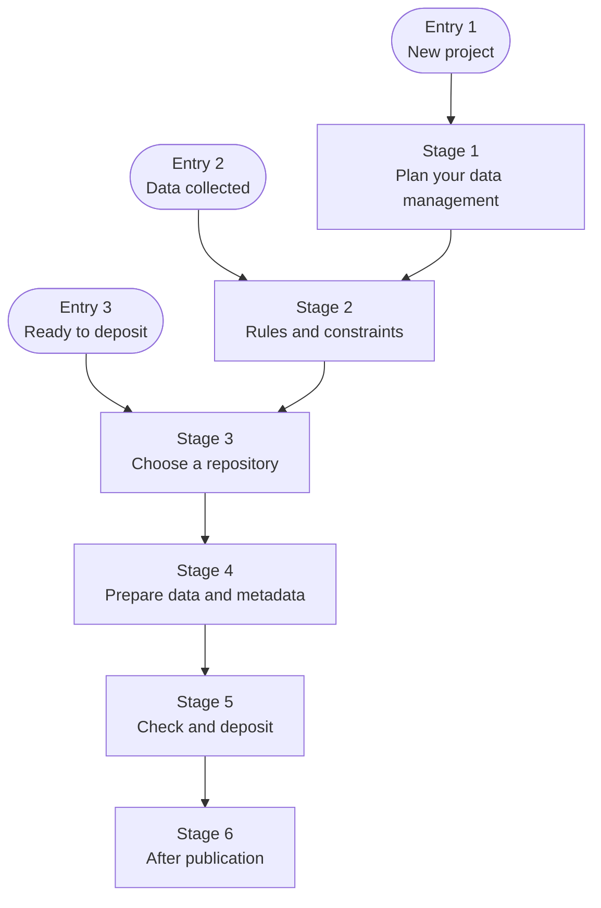

# The workflow

Looking after research data is not one task. It runs from the first plan, before you collect
anything, to long after your data are published. Data Director follows that whole path, so that
it can tell you where you are, what usually comes next and which specialist can help.

This page is a map. It explains the six stages, the three places you can join, and how you work
through them with the Data Director.

!!! note "Where this comes from"
    The stages follow the process flow in the Data Director Agentic AI Blueprint
    ([chapter 8](../../blueprint/08-process-flow.md)), the Research Data Alliance's community
    specification for this kind of tool. You do not need to have read it. This page explains each
    stage on its own terms, and the Blueprint's requirement numbers (R1 to R12, from its
    [functional specification](../../blueprint/07-functional-specification.md#71-functional-requirements))
    appear in brackets for anyone who wants to trace a step back to it.

**The workflow is yours.** The Data Director assists, recommends and flags. It does not direct your
work, and you can skip a step, repeat it or go back to an earlier one whenever that suits your
project.

## A few words you will meet

You do not need to know these before you start, and the Data Director explains them as they come
up. Here they are in one place.

| Term | What it means |
|---|---|
| **Data management plan (DMP)** | A document, often required by funders, that says how your data will be collected, documented, stored, protected, shared and kept, and who is responsible. It is meant to be kept up to date as the project goes on. |
| **Repository** | A service that stores and publishes research data and keeps it available, such as Zenodo or an institutional repository. Funders and journals often name the ones they accept. |
| **Metadata** | The information that describes your dataset: who made it, what it is about, when, under what licence, in what format. It is what lets other people find and understand your data. |
| **Metadata standard, vocabulary, ontology** | An agreed way of describing things so that different systems understand each other, for example one set of names for the fields of a record, or an agreed list of terms for a subject. |
| **README and data dictionary** | A README explains a dataset to a person coming to it for the first time. A data dictionary lists each variable or column: what it means, its units and its allowed values. |
| **Persistent identifier (PID)** | A permanent address for something, such as a DOI for a dataset or an ORCID iD for a person. It keeps working when web addresses change. |
| **Embargo** | A period during which published data are kept private, for instance until a related paper is out. |
| **FAIR** | The principle that data should be Findable, Accessible, Interoperable and Reusable. Much of what the Data Director does is to make data a little more FAIR. |
| **Deposit** | Putting your data and their metadata in a repository. |

The [glossary](../../glossary.md) has the terms the Data Director itself uses.

## Choose an entry point

Researchers do not always start at the beginning. Most people come to this with data already in
hand, and a deadline. Say which of these describes you.

| If you are… | You join at | And the Data Director starts with |
|---|---|---|
| **Starting a new project**, before you collect any data | Stage 1 | Planning how the data will be managed |
| **Holding data you have collected** and wanting to share them | Stage 2 | What you are allowed and expected to do with them |
| **Ready to deposit** and need to prepare the deposit | Stage 3 | Choosing a repository |

Wherever you join, you carry on through every later stage to the end. These are called the three
*entry points*: Entry 1, Entry 2 and Entry 3.

When you create a project, the Data Director first asks a few setup questions that place it in this
flow. They take the message box's place: select **Reply in my own words instead** to type a
message, and **Answer the setup questions instead** under the box to go back to them, as you left
them. A message you send leaves the questions to answer later. **Attach a file** beside the
questions adds a document to the project straight away. Once you have answered them, it tells you
which stage you start at and suggests a first step. Select **Start with** that step to begin the
conversation there, or **Not now** to close the questions and type your own message.

On a first message that names no entry point, the Data Director asks which one you mean, with the
three entry points as choices beneath its reply. Choose one and select **Send answer**, or type
your answer instead: "Entry 2", or your situation in your own words ("I have collected my data and
want to share it"). It then lists the steps from that entry onwards and the agents that can help
with each.

The Data Director asks other questions with a few known answers the same way. You never have to
use the choices: whatever you type in the message box is sent as your reply.

## The map

The Blueprint calls these "phases", and the app's **Data management phases** strip above the
conversation uses that word. A stage here is a phase there.

## The six stages

Each stage lists its steps in the order they usually come. Steps marked *optional* may be left out.
The steps are the Blueprint's, apart from a few marked *added*, which the Data Director includes
because a later step needs them.

### Stage 1: Plan your data management

*Entry 1 starts here.* **Question it answers: how will I look after my data from the start?**

This is the time to think about the whole life of the data, not only how they will be described:
how they will be collected, documented, stored and protected, shared and preserved, and for how
long; who is responsible; and what it will cost. Done early, it saves a great deal of work later.

- **Describe the project and the data it will produce** (*added*). Everything later plans from this.
  Attach your proposal or award letter and the Data Management Planner proposes what it says, for
  you to confirm.
- **Draft the data documentation** (R5). Before collection, a README that plans how the data will
  be documented.
- **Select vocabularies and ontologies** (R3). Agreed terms to describe your data with, from your
  field.
- **Plan storage, backup and security** (*added*). Where your data live while you work on them,
  who can reach them and how they are backed up.
- **Choose open formats to collect data in** (R3; *added*). So that your data need no conversion
  before you share them.
- **Create a data management plan** where you have none (*optional*).
- **Review and update the data management plan.**

If you say you have no plan, the review step is skipped. Once you write a plan here and approve it,
the review step opens again, so that the Data Management Planner can review your plan.

### Stage 2: Rules and constraints

*Entry 2 starts here.* **Question it answers: what am I allowed, and expected, to do with my data?**

These checks come before you choose a repository, because they limit your choices.

- **Check funder, journal and institutional policies on sharing data.**
- **Identify sensitive data.** For example, anything about identifiable people, or the location of a
  protected species.
- **Handle sensitive data.**
- **Confirm whether an embargo is needed.**
- **Check that what you plan to share matches the promises in your plan** (R8).

If the data may identify people, or consent is unsettled, the Data Director pauses the sharing
steps and points you to your institution's ethics and data protection staff. It does not give legal
or ethics advice.

### Stage 3: Choose a repository

*Entry 3 starts here.* **Question it answers: where should these data go?**

Choose the repository before you describe the data, because it decides which metadata fields,
vocabularies and checks apply in the next stage.

- **Check whether your funder, journal or institution requires a particular repository.**
- **Recommend a repository** where none is required (R1).
- **Confirm or arrange persistent identifiers** such as a DOI (R7).
- **Check access options and deposit costs.**
- **Check the repository's certification** (*optional*).

### Stage 4: Prepare data and metadata

**Question it answers: is my dataset ready for someone else to use?**

- **Clean and version the data files.** This is your work; the Data Director does not change your
  files.
- **Recommend open formats** (R3).
- **Create or review data documentation**: READMEs and data dictionaries (R5).
- **Identify the right metadata standard** for the repository and your field.
- **Complete the metadata**, using vocabularies and ontologies suited to your discipline (R2, R6).

### Stage 5: Check and deposit

**Question it answers: is everything right before I submit?**

The metadata are checked before you submit, while you can still act on what is found. The Data
Director builds the deposit package, and you then deposit it in the repository yourself, as
[Depositing your data](depositing.md) explains.

- **Validate the metadata** (R4).
- **Assign a licence.**
- **Link to related outputs**: publication DOIs, ORCID iDs, institution identifiers and grant
  numbers (R7).
- **Check how FAIR the draft record is** (*optional*; *added*, so that you can act on it before you
  deposit).
- **Set access restrictions.**
- **Generate a private link for peer reviewers** (*optional*).
- **Upload the files** ([Depositing your data](depositing.md)).
- **Review and finalise the submission.**

### Stage 6: After publication

**Question it answers: how do I keep my data useful?**

Publication is not the end. This stage is a loop you return to.

- **Update the data management plan** to reflect what was published.
- **Record the deposit in institutional systems** where required.
- **Monitor access, downloads and citations.**
- **Check when an embargo ends.**
- **Check how FAIR the published records are, and find related datasets** (R12).
- **Improve the metadata of datasets you published earlier** (R9).
- **Link datasets to related papers, people, grants and software** (R11).

In every stage, each action an agent takes on your data and metadata is recorded with its
evidence: see [What the Data Director records](records.md).

## How you work through it

1. **Say where you are.** Start a conversation ([Using the conversation](conversation.md)) and
   describe your situation or name your entry point.
2. **Read the plan.** The Data Director lists the steps from your entry point. For each step it
   shows the agents that can help.
3. **Hand a step to an agent.** The Data Director asks an agent for you, or you open the agent
   yourself and use its **Run** tab ([Running an agent](running-an-agent.md)). Behind the scenes,
   the part of the system that runs every agent, called the harness, checks that the agent kept to
   the rules and records the run.
4. **Check the result.** Every result carries an [outcome](outcomes.md) and the evidence it rests
   on. You decide what to do with it.
5. **Move on.** Continue to the next step, or return to an earlier one.

### Steps with no agent yet

Not every step has a specialist yet. Where no agent serves a step, the Data Director says so, gives
some background on what the step usually involves and offers steps it can help with. It does not
skip the step or pretend to do the work itself. Which steps have an agent depends on which agents
your deployment offers, so the list differs between deployments. [The agents](agents.md) lists
them and the steps each serves.

The **Data management phases** strip above the conversation in the app shows the same stages in
order. Open it to see, for each step, the agents here that serve it. It does not yet show where
your own project has reached in them (TODO(#160)).

## What is not covered

- **Governance as an entry point.** Routing researchers down open, restricted or unshared paths is
  deferred by the Blueprint to version 2.0.
- **The Blueprint's figures themselves.** The steps above are taken from the figure captions in
  [§8.2](../../blueprint/08-process-flow.md#82-six-phase-process-flow-for-research-data-publication).
  They may omit steps or decisions that the figures show (TODO(#245)).

## Where this is defined

For developers: the entry points and phases are data in the SDK (`dd_sdk.process_flow`), the same
for every agent and deployment. [Orchestration](../../specs/orchestration.md) records the decision;
the [Blueprint chapter](../../blueprint/08-process-flow.md) is the source.
