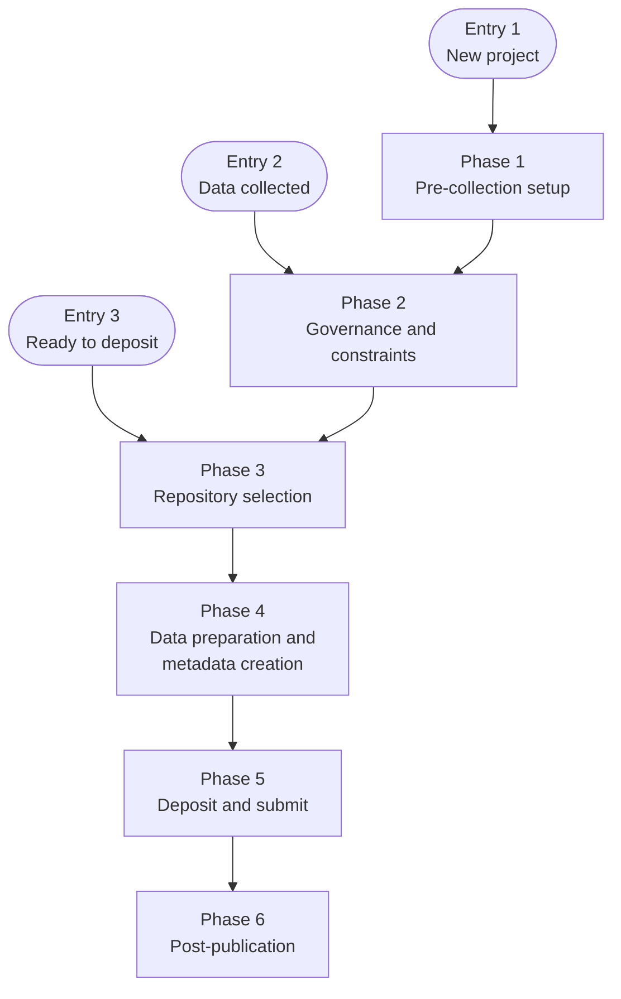

# The workflow: entry points and phases

Data Director follows the process flow in the Blueprint
([§8](../../blueprint/08-process-flow.md)): six phases, joined at one of three entry points. This
page is a map of that flow, so you can see where you are in your work and what the Data Director
can help with from there.

The workflow is yours. The Data Director assists, recommends and flags; it does not direct or
control your work, and you can skip, repeat or reorder steps to suit your project.

## Choose an entry point

Researchers do not always start at the beginning. Say which of the three describes you.

| Entry | Where you are | You join at |
|-------|---------------|-------------|
| **Entry 1** | Starting a new project, before data collection begins | Phase 1 |
| **Entry 2** | Data already collected, being prepared for sharing | Phase 2 |
| **Entry 3** | Ready to deposit data into a repository | Phase 3 |

All three continue through every later phase to the end.

In the chat, you can answer with "Entry 2", or describe your situation in your own words ("I have
collected my data and want to share it"). On a first message that names no entry point, the Data
Director asks which one you mean. It then lists the steps from that entry onwards and the agents
that can help with each.

## The map

## The phases and their steps

Each step names the Blueprint requirement it applies (R1 to R12, from
[§7.1](../../blueprint/07-functional-specification.md#71-functional-requirements)), where there is
one. Steps marked *optional* may be left out.

### Phase 1: Pre-collection setup

*Entry 1 starts here.*

- Draft the data documentation (R5)
- Select controlled vocabularies and ontologies (R3)

### Phase 2: Governance and constraints

*Entry 2 starts here.* These checks come before repository selection and constrain everything
after them.

- Check funder, journal and institutional data sharing policies
- Identify and handle sensitive data
- Confirm whether an embargo is required
- Verify data sharing commitments against the Data Management Plan (R8)

### Phase 3: Repository selection

*Entry 3 starts here.* Choose the repository before you create metadata: it decides the metadata
schema, vocabularies and validation rules for Phase 4.

- Check whether the funder, journal or institution mandates a repository
- Recommend a repository where none is mandated (R1)
- Confirm or arrange persistent identifier (PID) assignment (R7)
- Check access options and deposit costs
- Verify repository certification (*optional*)

### Phase 4: Data preparation and metadata creation

- Clean and version the data files
- Recommend open formats (R3)
- Create or review data documentation: READMEs and data dictionaries (R5)
- Identify the appropriate metadata standard
- Complete metadata fields with FAIR-aligned, discipline-appropriate vocabularies and ontologies
  (R2, R6)

### Phase 5: Deposit and submit

Metadata is validated before submission, while you can still act on what is found.

- Validate metadata quality (R4)
- Assign a licence
- Link to related research outputs: publication DOIs, ORCID, ROR and grant IDs (R7)
- Set access restrictions
- Generate a private peer review link (*optional*)
- Upload the files
- Review and finalise the submission

### Phase 6: Post-publication

Publication is not the end. This phase is a continuing loop.

- Record the deposit in institutional systems where required
- Monitor access, downloads and citations
- Check embargo release
- Evaluate the FAIRness of the published objects and discover related datasets (R12)
- Retrofit FAIR-aligned metadata for existing datasets (R9)
- Link datasets to related research outputs (R11)

In every phase, each action an agent takes on your data and metadata is recorded with its
evidence: see [What the Data Director records](records.md).

## How you interact with it

1. **Say where you are.** Start a conversation and name your entry point.
2. **Read the plan.** The Data Director lists the steps from your entry point. For each step it
   shows the requirement and the agents that serve it.
3. **Hand a step to an agent.** The Data Director delegates the step to an agent through the
   harness, or you open the agent directly and use its **Run** tab
   ([Running an agent](running-an-agent.md)). The harness checks the agent kept to the contract
   and records the run.
4. **Check the result.** Every result carries an [outcome](outcomes.md) and the evidence it rests
   on. You decide what to do with it.
5. **Move on.** Continue to the next step, or return to an earlier one.

### Steps with no agent

An agent joins a step by declaring the step, or the requirements, it serves. Where no registered
agent serves a step, the Data Director says "no agent yet", and gives the requirement if the
Blueprint names one. It does not skip the step
or do the work itself. The set of steps with an agent depends on which agents your deployment has
registered, so the list differs between deployments.

The **Blueprint phases** panel in the app shows the same phases and, for each step, the agents
here that serve it. It does not yet show where your own project has reached in them
(TODO(#160)).

## What is not covered

- **Data Management Plans.** Creating, reviewing and updating a plan is out of scope for the
  initial phase, so the steps for it in the Blueprint's figures are not offered
  (TODO(#284)).
- **Governance as an entry point.** Routing researchers down open, restricted or unshared paths is
  deferred by the Blueprint to v2.0.
- **The figures themselves.** The steps above are taken from the figure captions in
  [§8.2](../../blueprint/08-process-flow.md#82-six-phase-process-flow-for-research-data-publication).
  They may omit steps or decisions that the figures show (TODO(#245)).

## Where this is defined

The entry points and phases are data in the SDK (`dd_sdk.process_flow`), the same for every agent
and deployment. [ADR-0028](../../adr/0028-entry-points-and-serves.md) records the decision; the
[Blueprint chapter](../../blueprint/08-process-flow.md) is the source.
